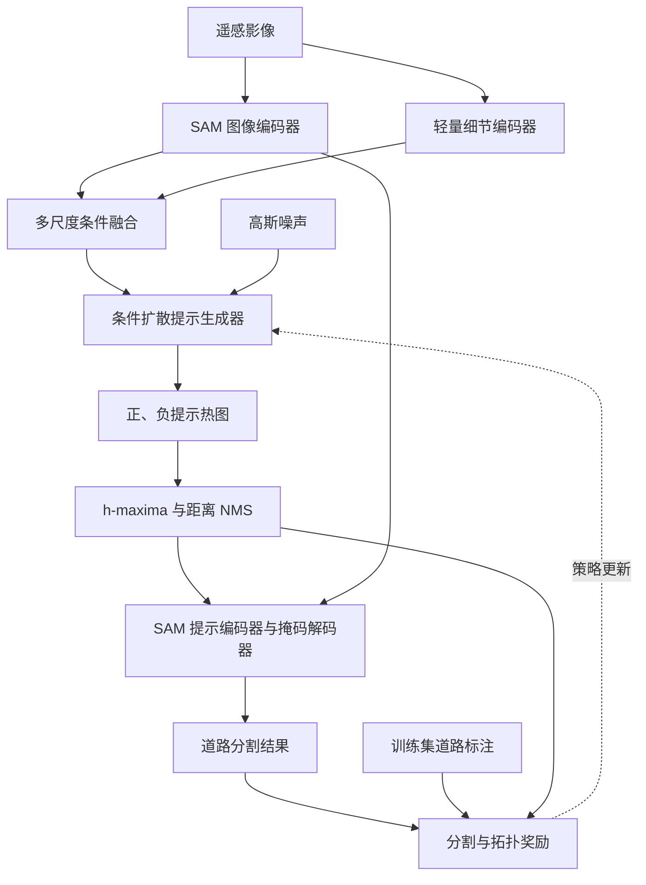

综合前面的讨论，建议将最终方案确定为 **“条件扩散生成双通道提示热图—显著峰值提取—SAM 道路分割—拓扑奖励后训练”**，可暂命名为 **DiffPeak-SAM**。

核心设计是：**把提示位置、数量和正负分配统一编码在两个热图中，通过固定的峰值提取算法得到提示点；强化学习直接优化热图生成策略。**这样既符合你的研究思路，也能形成较清晰的训练闭环。

以下给出一套可以直接据此实现的架构。网络规模、损失权重和阈值均是建议起点，不代表已经验证的最优配置。

---

**整体模型由四个功能模块组成，SAM 图像特征在提示生成与分割之间共享。**



其中：

- **条件特征模块**提供道路语义和局部细节；
- **扩散生成器**学习有效提示布局的条件分布；
- **峰值提取模块**将连续热图转换为可变数量的离散点；
- **SAM 分割模块**根据这些点生成道路掩码。

奖励分支仅在训练时使用。推理时，模型输入一张遥感影像即可输出道路分割。

---

**首先，使用共享的 SAM 编码器，并补充一个轻量细节分支。**

以 RGB 影像为例：

\[
I\in\mathbb R^{B\times3\times1024\times1024}.
\]

采用原版 SAM ViT-B，其图像编码器输出：

\[
F_s=E_{\mathrm{SAM}}(I)
\in\mathbb R^{B\times256\times64\times64}.
\]

这一尺寸与 SAM 官方配置一致。[GitHub](https://github.com/facebookresearch/segment-anything/blob/main/segment_anything/build_sam.py?utm_source=chatgpt.com)

考虑到道路细窄、边界复杂，仅使用 \(64\times64\) 特征可能限制提示定位精度，建议增加一个浅层 CNN：

\[
F_d=E_{\mathrm{detail}}(I)
\in\mathbb R^{B\times64\times256\times256}.
\]

具体可以采用：

| 层 | 配置 | 输出尺寸，省略批次维 |
|---|---|---|
| Conv 1 | \(3\times3\)，步长 2，32 通道 | \(32\times512\times512\) |
| Conv 2 | \(3\times3\)，步长 2，64 通道 | \(64\times256\times256\) |
| 残差块 × 2 | 64 通道，GroupNorm、SiLU | \(64\times256\times256\) |
| 条件融合 | 与上采样的 SAM 特征拼接，再卷积 | \(64\times256\times256\) |

融合公式为：

\[
C_{256}
=
\operatorname{Conv}
\left[
F_d,\operatorname{Up}_{4}(F_s)
\right].
\]

再用步长卷积构造条件金字塔：

\[
C=\{C_{256},C_{128},C_{64},C_{32}\},
\]

对应通道数设为：

\[
\{64,128,256,256\}.
\]

这里生成的是基于 SAM 特征与细节特征的多尺度表示，不应表述为“直接获得 SAM 原生多尺度特征”。

为了让融合特征包含道路结构信息，可以添加一个**训练阶段使用的辅助头**，预测道路区域和中心线：

\[
(\hat R,\hat S)=A(C_{256}).
\]

使用道路掩码及其骨架进行监督。辅助头不负责最终输出，推理时可以移除；也不使用它对提示点进行硬性前景筛选，避免其漏检直接排除潜在有效提示。

---

**双通道热图应监督“提示点响应”，而不是道路和背景的像素分类概率。**

定义：

\[
H=[H^+,H^-]\in[0,1]^{B\times2\times256\times256}.
\]

其中：

- \(H^+\)：适合产生正提示的位置；
- \(H^-\)：适合产生负提示的位置；
- 两个通道不需要逐像素相加为 1；
- 不需要提示的区域允许两个通道同时接近 0。

训练时，根据真实道路标注构造多种有效提示布局：

| 提示类型 | 建议采样方式 |
|---|---|
| 普通正点 | 沿道路中心线按随机间距采样，覆盖不同分支 |
| 结构关键正点 | 适量加入路口、可靠端点及困难路段上的道路位置 |
| 边界附近负点 | 在道路外侧、避开标注不确定边界的背景区域采样 |
| 困难负点 | 从阶段性分割模型的假阳性区域采样 |
| 普通负点 | 少量覆盖其他背景区域 |

正点采样间距与负点密度可以随机变化，使同一张影像对应多组合理提示，而不是固定一套坐标或固定点数。

将点集合转换为高斯响应：

\[
H^{c*}(u)
=
\max_{p\in P^{c*}}
\exp\left(
-\frac{\|u-p\|_2^2}{2\sigma_{\mathrm{target},c}^{2}}
\right),
\quad c\in\{+,-\}.
\]

无道路样本可以设置双通道目标热图均为零。

这里需要增加一个容易被忽视的检查：**生成监督热图后，先使用最终的峰值提取算法回提一次提示点，检查能否恢复预期位置和数量。**如果大量目标峰已经在热图构造阶段合并或被过滤，扩散模型即使准确拟合热图，也无法得到正确提示。

道路骨架和采样点应在原始标注分辨率下构造，再映射到热图坐标，避免细道路在下采样时消失。

---

**条件扩散生成器使用一个四尺度 U-Net，直接在双通道热图空间进行扩散。**

将目标热图映射到 \([-1,1]\)：

\[
z_0=2H^*-1.
\]

前向过程为：

\[
z_t=
\sqrt{\bar\alpha_t}z_0+
\sqrt{1-\bar\alpha_t}\epsilon,
\qquad
\epsilon\sim\mathcal N(0,I).
\]

去噪器输入带噪热图、时间步和影像条件：

\[
\hat\epsilon=\epsilon_\theta(z_t,t,C).
\]

建议的网络配置为：

| U-Net 层级 | 空间分辨率 | 通道数 | 条件注入方式 |
|---|---:|---:|---|
| Level 1 | \(256\times256\) | 64 | 融合 \(C_{256}\) |
| Level 2 | \(128\times128\) | 128 | 融合 \(C_{128}\) |
| Level 3 | \(64\times64\) | 256 | 融合 \(C_{64}\) |
| Bottleneck | \(32\times32\) | 256 | 融合 \(C_{32}\)，可加入交叉注意力 |
| 解码部分 | 对称上采样 | 对应编码层 | 跳跃连接 |
| 输出层 | \(256\times256\) | 2 | 预测双通道噪声 |

每层使用两个残差块，时间步通过正弦编码与 MLP 注入。第一版采用特征拼接与卷积融合即可，交叉注意力可作为独立增强项。

基础损失是：

\[
\mathcal L_{\mathrm{diff}}
=
\mathbb E
\left[
\|\epsilon-\epsilon_\theta(z_t,t,C)\|_2^2
\right].
\]

再增加较小权重的热图重建与结构辅助损失：

\[
\mathcal L_{\mathrm{pre}}
=
\mathcal L_{\mathrm{diff}}
+
\lambda_h\mathcal L_{\mathrm{heat}}
+
\lambda_a\mathcal L_{\mathrm{aux}}.
\]

其中：

- \(\mathcal L_{\mathrm{heat}}\)：根据预测噪声恢复干净热图，对峰值邻域与背景分别求平均后加权；
- \(\mathcal L_{\mathrm{aux}}\)：辅助道路区域与中心线监督；
- 热图重建项主要用于低、中噪声时间步，避免高噪声下的不稳定重建主导训练。

采样结束后，使用固定变换恢复热图：

\[
H=\operatorname{clip}\left(\frac{z_0+1}{2},0,1\right).
\]

**不对每张热图单独做 min-max 归一化，也不对两个通道做互斥 Softmax。**这样才能保持峰值幅度和绝对阈值的意义。

---

**提示提取采用固定的“h-maxima 显著峰检测 + 平顶处理 + 距离 NMS”。**

对每个通道独立执行：

\[
\widetilde H^c=G_{\sigma_{\mathrm{smooth}}}*H^c,
\]

\[
M^c=
\operatorname{HMaxima}(\widetilde H^c,h_c)
\cap
\{\widetilde H^c\ge\tau_c\}.
\]

h-maxima 根据峰的相对高度筛选局部极大值，并输出峰值区域的二值标记；绝对响应阈值 \(\tau_c\) 则负责排除低响应峰。[skimage 0.26.0 documentation](https://scikit-image.org/docs/stable/api/skimage.morphology.html?utm_source=chatgpt.com)

随后对峰值标记图做连通域标记，对每个峰顶区域 \(\Omega_i^c\) 选一个代表点：

\[
p_i^c=\arg\max_{u\in\Omega_i^c}\widetilde H^c(u).
\]

若是平顶，在并列最大值中选择距区域中心最近的像素，并固定平局处理规则。

最后按响应从高到低进行距离 NMS：

\[
p_i^c\text{ 被保留}
\iff
\min_{q\in P^c}\|p_i^c-q\|_2\ge r_c.
\]

这一步处理的是峰值区域，不是对整条道路做空间聚类。相连的高响应区域中，只要存在多个足够显著、间距合适的峰，就可以得到多个提示点。

完整算法可以固定为：

```text
输入：正、负热图 H+、H-
参数：平滑尺度 σ，显著性 h，绝对阈值 τ，最小间距 r

对每个通道：
    1. 轻度平滑热图
    2. 使用 h-maxima 得到显著峰值标记
    3. 删除绝对响应低于 τ 的峰
    4. 每个峰顶区域选择一个代表点
    5. 按响应降序执行距离 NMS
    6. 排除填充区域中的点

将坐标转换到 SAM 输入坐标系
输出正提示集合 P+ 和负提示集合 P-
```

提示数量自然得到：

\[
K^+=|P^+|,\qquad K^-=|P^-|.
\]

正、负通道分别执行 NMS；对坐标完全重合的异类提示进行固定规则的消歧即可，不宜进行大范围跨通道抑制。

建议先验证以下参数：

| 参数 | 初始配置 | 说明 |
|---|---:|---|
| 热图分辨率 | \(256\times256\) | 基础配置 |
| 目标高斯宽度 | 1～2 个热图像素 | 需通过回提检查校准 |
| 提取前平滑尺度 | 0～0.5 个热图像素 | 热图已平滑时可以关闭 |
| h-maxima 参数 \(h\) | 0.05 | 在固定 \([0,1]\) 尺度上使用 |
| 响应阈值 \(\tau\) | 0.3 | 正负通道可分别校准 |
| NMS 间距 \(r\) | 4 个热图像素 | 对应当前输入下约 16 个像素 |

这些参数在进入强化学习前确定，后训练和推理期间保持一致。

---

**SAM 分割分支先进行道路任务适配，再作为固定的奖励反馈模块。**

将全部正负点组成同一组提示：

\[
P=
\{(p_i^+,1)\}_{i=1}^{K^+}
\cup
\{(p_j^-,0)\}_{j=1}^{K^-}.
\]

模型输出：

\[
\hat Y=
D_\psi\left(
F_s,E_{\mathrm{prompt}}(P)
\right).
\]

基础版本采用：

- 冻结 SAM 图像编码器；
- 冻结提示编码器；
- 微调掩码解码器；
- 设置 `multimask_output=False`；
- 监督目标为该影像中的全部道路，而不是某一个局部道路实例。

SAM 接口使用 \((x,y)\) 坐标，正点标签为 1、负点为 0，提示坐标需与影像缩放及填充保持一致。其低分辨率掩码输出为 \(256\times256\)，再恢复到输入影像尺寸。[GitHub](https://github.com/facebookresearch/segment-anything/blob/main/segment_anything/predictor.py?utm_source=chatgpt.com)

微调损失可以采用：

\[
\mathcal L_{\mathrm{seg}}
=
\mathcal L_{\mathrm{BCE}}
+
\mathcal L_{\mathrm{Dice}}
+
\lambda_s\mathcal L_{\mathrm{soft\text{-}clDice}}.
\]

soft-clDice 提供中心线与区域一致性的可微监督，适合道路等细长结构。[arxiv.org](https://arxiv.org/abs/2003.07311?utm_source=chatgpt.com)

训练时覆盖不同数量和布局的提示，并在扩散预训练完成后加入实际生成的提示，再适配一轮解码器。这样可以缩小“人工构造提示”和“模型生成提示”的差异。

对无正峰的情况，建议规定：**返回空道路掩码，不强行补充全局最大点。**该规则在训练奖励计算和推理时保持一致。若有道路却未生成正峰，模型会获得较低分割奖励；同时，真实无道路影像能够输出空结果。

---

**强化学习阶段只更新扩散生成器，以最终分割结果作为反馈。**

将固定峰值提取器记为 \(\mathcal P\)，道路适配后的 SAM 记为 \(S_\psi\)，目标为：

\[
\max_\theta
\mathbb E_{H\sim p_\theta(H\mid I)}
\left[
R\left(S_\psi(I,\mathcal P(H)),Y,\mathcal P(H)\right)
\right].
\]

采用 DDPO 思路，将每一步去噪视为一个动作：

\[
s_t=(z_t,t,C),\qquad a_t=z_{t-1},
\]

\[
p_\theta(z_{t-1}\mid z_t,C)
=
\mathcal N\left(
\mu_\theta(z_t,t,C),\sigma_t^2I
\right).
\]

DDPO 的核心就是利用终端下游奖励，对扩散去噪过程进行策略梯度优化。[rl-diffusion.github.io](https://rl-diffusion.github.io/?utm_source=chatgpt.com)

在你的模型中，强化学习能够改变：

| 热图变化 | 对提示的影响 |
|---|---|
| 峰中心移动 | 提示位置变化 |
| 峰显著性或幅度变化 | 提示被保留或过滤 |
| 新峰产生、旧峰消失 | 提示数量变化 |
| 两个通道的峰布局变化 | 正点与负点分配变化 |

因此，“优化提示数量”是通过峰的出现与消失实现的隐式优化，不需要额外数量策略。

建议对每张影像采样 \(G=4\) 条轨迹，用同一影像其他轨迹的奖励均值作为基线：

\[
A_i=
R_i-\frac{1}{G-1}\sum_{j\ne i}R_j.
\]

然后对每一步构造新旧策略概率比：

\[
\rho_{i,t}
=
\frac{
p_\theta(z_{t-1}^{(i)}\mid z_t^{(i)},C)
}{
p_{\theta_{\mathrm{old}}}
(z_{t-1}^{(i)}\mid z_t^{(i)},C)
},
\]

并采用 PPO 裁剪目标更新：

\[
\mathcal L_{\mathrm{DDPO}}
=
-\mathbb E_{i,t}
\left[
\min\left(
\rho_{i,t}A_i,
\operatorname{clip}(\rho_{i,t},1-\varepsilon,1+\varepsilon)A_i
\right)
\right].
\]

后训练总损失为：

\[
\mathcal L_{\mathrm{post}}
=
\mathcal L_{\mathrm{DDPO}}
+
\lambda_{\mathrm{KL}}\mathcal L_{\mathrm{KL}}
+
\lambda_{\mathrm{anchor}}\mathcal L_{\mathrm{diff}}.
\]

其中，KL 项限制策略偏离预训练模型，扩散监督项避免热图结构在奖励优化中退化。

有三个实现要点：

1. **采样时保存每一步状态、动作和旧策略对数概率；更新时对固定采样结果重新计算概率。**
2. **峰值提取和 SAM 奖励计算不需要反向传播。**梯度来自扩散动作的对数概率。
3. **用于计算高斯策略概率的转移必须有非零方差。**基础实现可以对各转移设置小的方差下限，包括末步，并将热图裁剪作为固定后处理；不能直接对零方差的确定性步骤计算高斯对数概率。

由于峰值提取对小幅热图扰动可能不敏感，奖励存在分段不变性。监督预训练、同图多轨迹基线、小学习率和 KL 约束都用于缓解这一问题，但仍需通过实验检查奖励方差和有效更新比例。

---

**奖励函数以分割质量为主，提示成本用于抑制无效峰。**

建议定义：

\[
R=
\alpha R_{\mathrm{IoU}}
+
\beta R_{\mathrm{clDice}}
+
\gamma R_{\mathrm{path}}
-
\lambda_N\frac{K^++K^-}{K_{\mathrm{ref}}}.
\]

这里 \(K_{\mathrm{ref}}\) 只是归一化常数，不是固定点数，也不是点数上限。

三种质量项的职责不同：

| 奖励 | 主要作用 | 局限 |
|---|---|---|
| IoU | 保证道路区域的像素精度 | 对细小但关键的断裂可能不够敏感 |
| clDice | 强调中心线覆盖与区域一致性 | 不能完整代表长距离路径可达性 |
| 路径奖励 | 惩罚断路、绕路和错误连接 | 依赖图构建与节点匹配，计算更复杂 |

第一版可以先用：

\[
R=
0.6\,\mathrm{IoU}
+
0.4\,\mathrm{clDice}
-
0.05\frac{K^++K^-}{32}.
\]

稳定后再加入路径项，例如：

\[
R=
0.5\,\mathrm{IoU}
+
0.3\,\mathrm{clDice}
+
0.2\,R_{\mathrm{path}}
-
0.05\frac{K^++K^-}{32}.
\]

路径奖励可以采用固定数量的抽样路径比较：

\[
R_{\mathrm{path}}
=
\frac1M
\sum_{i=1}^{M}
\mathbf1_{\text{端点匹配且路径存在}}
\max\left(
0,\,
1-\frac{|\hat d_i-d_i|}{d_i+\epsilon}
\right).
\]

建议真实图到预测图、预测图到真实图双向计算，兼顾断裂与错误连接。该项属于抽样代理奖励，最终评估仍可使用正式 APLS；APLS 根据真实与预测路网中的路径长度差异衡量路网质量。[GitHub](https://github.com/CosmiQ/apls?utm_source=chatgpt.com)

空标注、空预测及不存在有效路径对的样本需要预先规定规则。例如，两者均空时给予正确空预测得分；只有一方为空时质量得分为零；无法评估路径项时，按预定规则使用其余质量项。

如果只有二值道路标注，由骨架生成的图不能可靠区分立交跨越与平面交叉，因此应将这部分结果表述为**标注所表达的道路连通性**。

---

**训练采用四个阶段，各阶段有明确的更新范围。**

| 阶段 | 更新参数 | 主要监督 | 完成目标 |
|---|---|---|---|
| A：道路适配与特征预热 | SAM 掩码解码器、细节编码器、条件融合、辅助头 | 道路分割与结构辅助损失 | 建立道路分割能力和条件特征 |
| B：扩散预训练 | 扩散 U-Net、条件融合与细节分支、辅助头 | 扩散损失、热图重建、结构辅助损失 | 学会产生有效提示热图 |
| C：生成提示适配 | SAM 掩码解码器 | 使用生成提示计算分割损失 | 适应真实生成提示的误差分布 |
| D：奖励后训练 | 扩散 U-Net | DDPO、KL、扩散锚定损失 | 优化峰值布局与提示效率 |

SAM 图像编码器和提示编码器在基础方案中始终冻结。进入阶段 D 后，条件特征模块与 SAM 掩码解码器也冻结。

阶段 D 的一次训练循环为：

```text
1. 读取训练影像 I 和道路标注 Y
2. 计算并复用影像条件特征
3. 对同一影像采样 G 条扩散轨迹
4. 对每组热图执行固定的峰值提取
5. 用冻结的 SAM 预测道路掩码
6. 计算分割、拓扑和提示成本奖励
7. 计算同图轨迹之间的优势值
8. 用 DDPO 更新扩散生成器
9. 同时施加 KL 约束和扩散监督锚定
```

这属于使用训练集标注计算奖励的后训练，不是无监督学习。验证集用于选取提取阈值、损失权重和模型检查点，测试集不能参与提示选择或奖励优化。

一个可用的起始配置是：

| 项目 | 建议起点 |
|---|---|
| SAM | ViT-B |
| 输入尺寸 | \(1024\times1024\) |
| 提示热图 | 双通道 \(256\times256\) |
| 扩散训练时间步 | 1000 |
| 每次生成采样步数 | 20 |
| 每图后训练轨迹数 | 4 |
| 扩散预训练学习率 | \(10^{-4}\) 量级 |
| 扩散后训练学习率 | \(10^{-6}\)～\(10^{-5}\) 量级 |
| 提示数量 | 由有效峰数决定 |
| 主实验推理 | 单次采样，固定评估协议 |

推理时依次完成条件编码、热图采样、峰值提取和 SAM 解码。若把后训练时的随机采样替换为更快的确定性采样，需要重新验证性能，不能默认两者等价。

---

**实验应重点验证提示机制是否真正有效，以及扩散和奖励后训练分别带来了什么。**

| 实验 | 要回答的问题 |
|---|---|
| 相同特征与 SAM，使用确定性 CNN 预测热图 | 扩散生成是否优于直接热图回归？ |
| 扩散预训练与奖励后训练对比 | 下游奖励能否改善提示布局？ |
| 普通局部最大值与 h-maxima 对比 | 峰显著性筛选是否减少噪声提示？ |
| h-maxima 与 h-maxima + NMS 对比 | 距离抑制是否改善冗余与覆盖？ |
| 正点提示与正负双通道提示对比 | 负点是否抑制困难背景误检？ |
| 移除提示成本 | 少量提示是否来自明确的成本约束？ |
| IoU、加入 clDice、加入路径项 | 各类奖励对精度和连通性的贡献是什么？ |
| 移除或打乱提示点 | 适配后的 SAM 是否确实依赖提示？ |
| 相同 SAM 编码器直接预测道路掩码 | 提示生成路线是否具有实际价值？ |

建议同时报告：

- IoU、F1、clDice，以及适用时的 APLS；
- 平均与高分位正负提示数量；
- 提示落点正确率、道路存在但未产生正峰的比例；
- 单次采样性能和多随机种子波动；
- 完整推理耗时，包括扩散、峰值提取和 SAM 解码。

如果细窄道路仍然表现不佳，应分别检查**提示坐标量化误差**与 **SAM 低分辨率掩码的表达限制**。将提示热图提高到 \(512\times512\) 主要改善前者；若瓶颈在掩码解码，则需要单独评估细节特征融合或边界细化模块，不能把所有误差都归因于提示点。