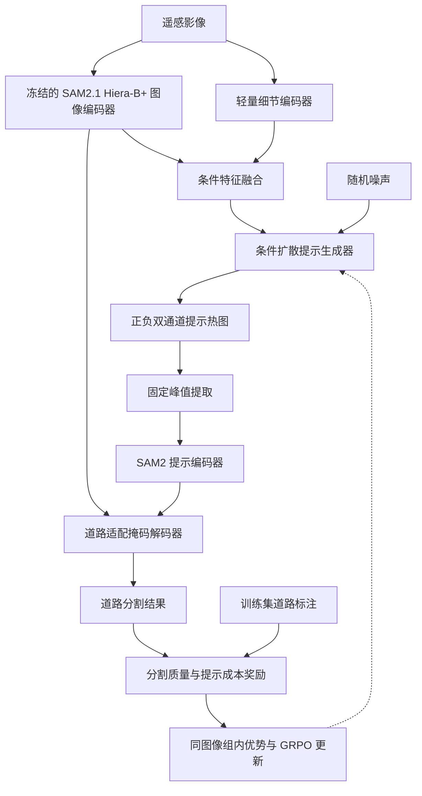

目标实现采用 **“条件扩散提示热图生成＋固定峰值提取＋道路适配 SAM2.1＋GRPO 后训练”** 的架构，骨干为官方 **SAM2.1 Hiera-B+（base_plus）**：权重 `sam2.1_hiera_base_plus.pt`，官方配置 `configs/sam2.1/sam2.1_hiera_b+.yaml`，源码固定 commit `2b90b9f5ceec907a1c18123530e92e794ad901a4`。接口测试与 3090 有界探针结果见 [实测记录](probe_3090.md)；本文负责结构与数学语义，不把开发结果当作正式模型效果。

其中，**GRPO 优化的是扩散模型产生高质量提示点集合的概率**；峰值提取负责把热图确定性地转换成点。整个模型不设置空间聚类模块、提示数量预测头或独立的正负点分配策略网络。

以下说明当前结构。执行数值统一见 `configs/3090.yaml`；已测参数、筛选预算与尚未确认的阶段长度/收敛效果见实测记录，避免在设计稿中重复列猜想参数。

---

**一、整体结构由一条分割路径和一条训练反馈路径组成。**

训练时，同一图像生成多套热图并比较奖励；推理时，默认只生成一套热图，不需要标注、奖励计算或组内比较。

---

**二、图像条件编码：共享 SAM2 语义特征，补充细道路的空间细节。**

以 \(1024\times1024\) 的 RGB 图像块为例，选用 **SAM2.1 Hiera-B+（base_plus）**。

| 模块 | 当前结构 | 输出 |
|---|---|---|
| SAM2 图像编码器 | 预训练 Hiera-B+ 与 FPN neck，冻结 | \(256\times64\times64\) 图像嵌入，外加 \(64\times128\times128\)、\(32\times256\times256\) 高分辨率特征 |
| 细节编码器 | 两级步长为 2 的卷积，配合残差块 | \(64\times256\times256\) |
| 特征融合 | SAM2 图像嵌入降维、上采样，与细节特征拼接后卷积 | \(64\times256\times256\) |
| 条件金字塔 | 连续下采样 | 256、128、64、32 四种空间尺度 |

融合可以写为：

\[
C_{256}=
\operatorname{Conv}\left(
\left[
F_{\mathrm{detail}},
\operatorname{Up}_{4}\big(\operatorname{Conv}_{1\times1}(F_{\mathrm{SAM2}})\big)
\right]
\right).
\]

再构建：

\[
\{C_{256},C_{128},C_{64},C_{32}\}.
\]

这里，细节编码器用于保留道路边缘、窄路和局部纹理。**它属于结构上的合理补充，不能单独作为主要创新点。**

SAM2 的图像特征同时供扩散模型和掩码解码器使用，避免重复编码。同一图像的多个 GRPO 候选也共享这些特征。SAM2 图像编码器并不只输出 \(64\times64\) 的嵌入：FPN neck 还产生 \(128\times128\) 与 \(256\times256\) 的高分辨率特征。**这些 high-res features 是解码器恢复细道路边界的必需输入，迁移时必须显式保留并传入 mask decoder，不能只使用图像嵌入。**SAM2 原始实现本身就将图像编码、提示编码和掩码解码分开。[GitHub](https://github.com/facebookresearch/sam2)

---

**三、扩散生成器直接建模双通道“提示适宜性热图”。**

定义：

\[
H=[H^+,H^-]\in[0,1]^{2\times256\times256}.
\]

其中：

- \(H^+\)：适合作为正提示的位置；
- \(H^-\)：适合作为负提示的位置。

**这两张图不是道路概率图及其补集。** 大多数背景区域没有放置负提示的必要，因此不应设置 \(H^-=1-H^+\)，也不使用正负两通道之间的 Softmax。

当前实现使用四尺度条件 U-Net：

| 分辨率 | 主干通道数 | 结构 |
|---|---:|---|
| \(256\times256\) | 64 | 两个残差块，融合 \(C_{256}\) |
| \(128\times128\) | 128 | 两个残差块，融合 \(C_{128}\) |
| \(64\times64\) | 256 | 两个残差块，融合 \(C_{64}\) |
| \(32\times32\) | 256 | 残差块＋注意力，融合 \(C_{32}\) |
| 上采样路径 | 对称设置 | 跳跃连接恢复空间细节 |
| 输出层 | 2 | 预测两个通道的噪声 |

时间步通过正弦编码和 MLP 注入残差块；图像条件通过逐尺度拼接或仿射调制注入。第一版采用逐尺度拼接即可。

将目标热图映射到：

\[
x_0=2H-1,
\]

采用标准加噪形式：

\[
x_t=\sqrt{\bar\alpha_t}x_0+
\sqrt{1-\bar\alpha_t}\epsilon,
\qquad
\epsilon\sim\mathcal N(0,I).
\]

监督预训练目标为：

\[
\mathcal L_{\mathrm{diff}}
=
\mathbb E\left[
\|\epsilon-\epsilon_\theta(x_t,t,C)\|_2^2
\right].
\]

第一版先使用标准噪声预测损失。如果出现峰值恢复不足，再加入低噪声阶段的峰值区域重建辅助损失，避免一开始堆叠多个损失项。

---

**四、预训练热图应由稀疏提示点构造，不能直接使用道路二值掩码。**

如果直接让模型拟合道路掩码，容易产生沿道路延伸的高值脊线，而不是可稳定提取的独立峰。

从训练标注构造多种有效点集：

| 点类型 | 采样位置 |
|---|---|
| 正提示 | 道路骨架上的分散位置，适当增加路口、端点附近的覆盖 |
| 负提示 | 道路外侧的背景带，避开标注边界的不确定区域 |
| 补充负提示 | 少量远处背景，或训练阶段发现的易误分区域 |

同一幅图像应随机改变骨架采样起点、间距和背景采样位置，形成多套监督点集。数量随采样结果变化，不需要训练数量预测器。

对每个通道分别生成高斯峰：

\[
H^{c,*}(u)
=
\max_{p\in P^{c,*}}
\exp\left(
-\frac{\|u-p\|_2^2}{2\sigma_h^2}
\right),
\qquad c\in\{+,-\}.
\]

没有该类点时，对应通道为零。

高斯宽度由 `configs/3090.yaml` 的 `data.heatmap_sigma` 指定（热图像素），不在本文重复数值。采用最大值叠加，避免多个邻近点累加造成峰值幅度失控。

这些点是**预训练初始化目标**，不是最优提示真值。后续 GRPO 的作用就是根据实际分割效果修正这种启发式初始化。

---

**五、峰值提取采用“h-maxima＋绝对阈值＋平台去重＋距离抑制”。**

对正负热图分别执行以下固定流程：

1. 轻度高斯平滑，抑制扩散残留噪声。
2. 使用 h-maxima 提取具有足够突出程度的峰。
3. 去掉绝对响应低于阈值的峰。
4. 一个平顶峰区域只保留一个代表像素。
5. 按峰值响应排序，执行最小距离抑制。
6. 合并正负点，处理同一位置的标签冲突。

h-maxima 中的 \(h\) 控制峰的突出程度，绝对阈值 \(\tau\) 控制峰本身的响应高度，两者作用不同。该算子是已有形态学方法。[skimage documentation](https://scikit-image.org/docs/stable/api/skimage.morphology.html)

协议使用的平滑标准差、\(h\)、绝对阈值和同类点最小距离统一见
`configs/3090.yaml` 的 `peaks`，本文不复制参数表；距离均为热图像素，需在验证集
上校准并在 GRPO 阶段冻结。不同地面分辨率的数据应考虑距离参数的物理尺度。

需要明确三个细节：

- **只对峰的平台区域做连通域标记**，不是对道路区域或提示点做空间聚类。
- 不设置固定 Top-K，最终点数由合格峰数量决定。
- 不做逐图 Min-Max 归一化，否则微弱噪声也可能被拉伸成高置信度峰。

如果正负峰映射到同一位置，可以保留响应较高者，完全相同则同时删除；不要用过大的跨类别抑制半径，以免删除道路旁有用的负点。

**没有正峰时允许输出空道路掩码**，使空白图像有明确处理规则；有道路图像上的这种行为会受到低分割奖励。不要利用真实标注强制补点。

---

**六、SAM2 应先适配“整幅道路语义分割”，再固定为 GRPO 的评价环境。**

将正负点组成同一个提示集合：

\[
P=\{(p_j,l_j)\}_{j=1}^{N},
\qquad l_j\in\{1,0\}.
\]

所有点共同输入提示编码器，掩码解码器输出整个图像块的道路掩码，采用单掩码输出模式。

道路可能包含多个互不连接的部分，SAM2.1 的通用对象分割能力不能保证直接满足这一要求。因此先训练道路掩码解码器，并同时传入图像嵌入与两级高分辨率特征：

\[
\mathcal L_{\mathrm{SAM2}}
=
\mathcal L_{\mathrm{BCE}}
+\mathcal L_{\mathrm{Dice}}
+\lambda_{\mathrm{cldice}}\,\mathcal L_{\mathrm{soft\text{-}clDice}}.
\]

其中的权重由 `train.cldice_weight` 给出，本文不重复数值。冻结图像编码器与提示编码器，只更新掩码解码器。soft-clDice 是面向管状、网络状结构的已有损失，可用于道路结构适配。[clDice 论文](https://arxiv.org/abs/2003.07311)

训练提示应包含多种数量、位置扰动和一定程度的缺失，使解码器适应自动生成的提示。待扩散模型可用后，再用训练图像上生成的提示进行一次短暂适配。

随后冻结整个 SAM2。

**必须检查提示是否仍然有效：** 对正确提示、打乱提示和移除提示分别测试。如果结果几乎不变，说明解码器可能已主要依赖图像完成分割，GRPO 优化提示的空间就很小。

---

**七、GRPO 在去噪轨迹上更新，通过最终分割结果提供终端奖励。**

对一幅图像，固定条件特征 \(C\)，使用旧策略采样 \(G\) 条轨迹：

\[
x_T^i\rightarrow x_{T-1}^i\rightarrow\cdots\rightarrow x_0^i,
\qquad i=1,\ldots,G.
\]

每个去噪步骤定义为具有已知密度的随机转移：

\[
p_\theta(x_{t-1}\mid x_t,C)
=
\mathcal N\left(
\mu_\theta(x_t,t,C),\sigma_t^2I
\right).
\]

状态是 \((x_t,t,C)\)，动作是下一步热图状态 \(x_{t-1}\)，完整轨迹结束后才计算奖励。

这是借鉴 DDPO 的去噪决策建模，并引入 GRPO 的组内优势估计；不是直接照搬语言模型的 token 训练过程。[DDPO 论文](https://rl-diffusion.github.io/files/paper.pdf)

**实现上采用固定方差的随机高斯采样器，所有纳入策略更新的步骤都保持非零方差。** 包括末步在内，可设置很小但非零的方差下限（数值见 `diffusion.min_std`）；最终采样完成后再映射、截断成有效热图。需要验证这个末步噪声不会明显破坏峰值。

不要把确定性 DDIM 步骤直接代入高斯概率比，也不要把热图响应值当作策略概率。

得到热图与提示后：

\[
H_i=\operatorname{clip}\left(\frac{x_0^i+1}{2},0,1\right),
\quad
P_i=\mathcal E(H_i),
\quad
M_i=\operatorname{SAM2}(I,P_i).
\]

奖励由 `configs/3090.yaml` 的 `reward.*` 定义，形式为：

\[
R_i=
w_{\mathrm{iou}}\operatorname{IoU}(M_i,Y)
+w_{\mathrm{cldice}}\operatorname{clDice}(M_i,Y)
+w_{\mathrm{path}}\operatorname{path}(M_i,Y)
-c_{\mathrm{point}}\frac{|P_i|}{N_{\mathrm{ref}}}.
\]

其中 \(N_{\mathrm{ref}}\) 只是成本归一化尺度（`reward.point_reference`），不是
提示数量上限；所有系数以配置为准，本文不复制数值。路径项默认关闭；成本项应在
分割质量稳定后按预注册的消融单独评估，不能在中途只给本方法改奖励。

对于没有道路的图像，应另行定义空掩码得分和假阳性惩罚，避免空集的 IoU、clDice 计算产生歧义。第一版可将其作为单独规则处理。

组内优势为：

\[
A_i=
\operatorname{stopgrad}\left[
\frac{R_i-\bar R}
{\max(s_R,\delta)}
\right].
\]

其中 \(\bar R,s_R\) 均只由**同一图像**的 \(G\) 个候选计算。完全同奖励的组跳过策略项；方差下限 \(\delta\) 防止放大微小奖励噪声。

概率比为：

\[
r_{i,t}(\theta)
=
\exp\left[
\log p_\theta(x_{t-1}^i\mid x_t^i,C)
-\log p_{\mathrm{old}}(x_{t-1}^i\mid x_t^i,C)
\right].
\]

训练目标为：

\[
\mathcal L_{\mathrm{RL}}
=
-\frac{1}{GT}\sum_{i,t}
\min\left[
r_{i,t}A_i,\,
\operatorname{clip}(r_{i,t},1-\epsilon,1+\epsilon)A_i
\right]
+\beta\mathcal K_{\mathrm{ref}}.
\]

\(\mathcal K_{\mathrm{ref}}\) 约束当前去噪策略不要过度偏离冻结的预训练策略。使用相同固定方差时，可以直接计算高斯分布之间的 KL。

组相对优势与裁剪更新在视觉生成中的应用已有 Flow-GRPO 先例；这里将其适配到提示热图和分割奖励。[Flow-GRPO 论文](https://arxiv.org/html/2505.05470v2)

高维热图的联合对数概率应按动作维度求和。若为了稳定改成维度平均，需要明确这是修改后的代理目标，不能仍将其称为原始联合概率比。第一版应使用小学习率、少量更新轮次，并监测 KL 和裁剪比例。

---

**八、训练时各模块的更新范围如下。**

| 模块 | SAM2 道路适配 | 扩散监督预训练 | GRPO 后训练 |
|---|---|---|---|
| SAM2 图像编码器 | 冻结 | 冻结 | 冻结 |
| 细节编码器与条件融合 | 不参与 | 训练 | 冻结 |
| 扩散 U-Net | 不参与 | 训练 | 训练 |
| 固定峰值提取器 | 无参数 | 无参数 | 无参数 |
| SAM2 提示编码器 | 冻结 | 冻结 | 冻结 |
| SAM2 掩码解码器 | 训练 | 冻结 | 冻结 |
| SAM2 高分辨率特征 | 冻结 | 冻结 | 冻结 |
| 预训练参考扩散模型 | 不参与 | 不参与 | 冻结 |

在 GRPO 阶段：

- 当前策略 \(\theta\)：接受梯度更新；
- 旧策略 \(\theta_{\mathrm{old}}\)：用于收集本轮轨迹，轮次间同步；
- 参考策略 \(\theta_{\mathrm{ref}}\)：始终固定为预训练检查点。

**旧策略和参考策略用途不同，不能混为一个模型。**

不同时训练 SAM2 和扩散模型，否则奖励环境会随更新变化，难以判断改进到底来自提示还是分割器。

---

**九、实现顺序：先验证学习信号，再扩大训练。**

1. **道路适配。**  
   使用标注采样提示，训练 SAM2 掩码解码器（含高分辨率特征输入）。

2. **扩散预训练。**  
   训练条件编码模块与 U-Net，验证生成热图能否恢复有用峰值。

3. **生成提示适配。**  
   用预训练扩散模型生成的训练集提示，短暂调整 SAM2 解码器，然后彻底冻结。

4. **组采样诊断。**  
   每幅图像按配置的 `rl.group_size` 生成多套提示，检查点集差异和奖励差异。若大多数候选提取出相同点集，先处理探索不足。

5. **GRPO 后训练。**  
   只更新扩散 U-Net；训练采样器和推理采样器先保持一致。

当前所有数值起点（输入/热图几何、扩散时间步、生成步数、每图候选数 \(G\)、
学习率、更新轮数、优化器和推理候选数）统一见
[`configs/3090.yaml`](../configs/3090.yaml)，本文不复制推荐参数表。这些都是
待确认的候选值，不是最优结论；GRPO 的裁剪阈值和 KL 系数应根据实际概率比尺度
校准，不建议直接照搬语言模型的默认配置。

推理时不使用真实标注挑选最佳候选。若以后增加多候选推理，必须另行定义不依赖标注的选择方式，并计入推理成本。

---

**十、这套设计需要重点验证“提示是否真的变得更有效”。**

至少记录：

- IoU、F1、clDice，以及独立的路径连通性指标；
- 正负提示数量与总推理时间；
- 组内不同提示点集的比例；
- 组内奖励方差、无效更新组比例；
- 策略 KL 与概率比裁剪比例。

clDice 可以提供结构反馈，但不能替代路径可达性评价。最终实验还应比较“确定性热图＋相同峰值算法”、扩散预训练模型，以及相同预算下的 DDPO 基线。

这套架构的研究重点可以明确为：

> **利用同图像候选提示集合的组相对分割反馈，后训练条件扩散模型，使固定峰值提取器产生更有利于道路连通性的正负提示点。**

需要由实验支撑的是：**在匹配提示数量和计算预算后，GRPO 是否改善了提示位置及其组合效果。**